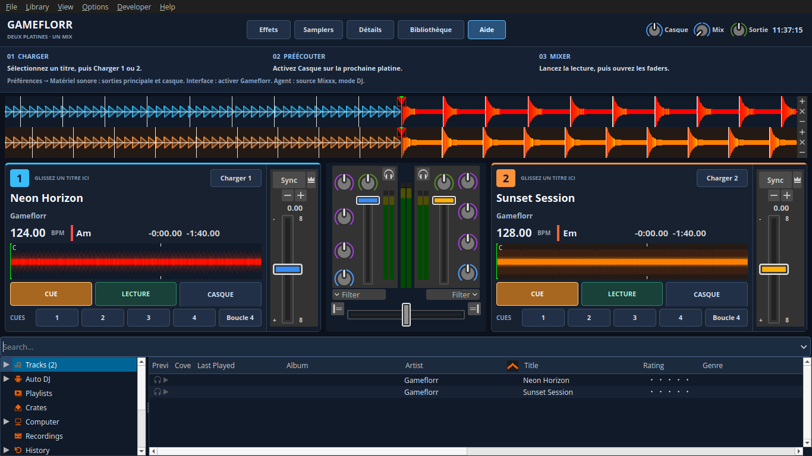

Texte généré par Codex (IA).

# Interface Gameflorr

Gameflorr est un skin natif à deux platines visibles, dérivé de Deere. Il conserve le moteur audio, les raccourcis et les mappings de contrôleur Mixxx. Il est sélectionné par défaut sur une nouvelle installation de ce fork. Un skin déjà sélectionné reste sélectionné.

## Choisir le skin

Dans **Préférences → Interface**, choisissez **Gameflorr** dans la liste des skins et appliquez. Les autres skins restent disponibles. Utilisez une fenêtre d'au moins **1280 × 720** ; sur un portable, masquez **Aide** après la prise en main pour agrandir la bibliothèque.

## Charger, écouter, mixer

1. Recherchez un morceau dans la barre au-dessus de la bibliothèque. Sélectionnez sa ligne, puis **Charger 1** ou **Charger 2**. Le glisser-déposer reste disponible.
2. Activez **CASQUE** sur la platine à préparer. Réglez le volume **Casque** et le mélange **Mix** dans la barre supérieure. La sortie casque doit être configurée dans **Préférences → Matériel sonore**.
3. Utilisez **CUE**, **LECTURE / PAUSE**, le tempo et **Sync**. Les quatre pads créent ou rappellent les points cue selon le comportement natif Mixxx. **Boucle 4** active ou quitte une boucle de quatre temps.
4. Utilisez les égaliseurs, les faders et le crossfader au centre pour faire la transition. La sortie principale se règle avec **Sortie**.

## Afficher davantage de commandes

- **Détails** : grille rythmique, réglages de boucles et sauts.
- **Effets** : unités d'effets Mixxx.
- **Samplers** : lecteurs de samples Mixxx.
- **Bibliothèque** : vue agrandie avec transports compacts ; cliquez à nouveau pour revenir au mix.
- **Aide** : rappel des trois étapes et des réglages initiaux.

Le choix Aide et le dernier panneau avancé sont mémorisés. Détails, Effets et Samplers s’affichent un à la fois pour préserver la place des commandes et de la bibliothèque. Cliquez à nouveau sur le panneau actif pour le fermer. Masquer les effets ou les samplers ne coupe pas leur son. Sur un petit écran, affichez les panneaux selon vos besoins.

Le skin affiche uniquement les platines 1 et 2. Les platines 3 et 4 restent disponibles au moteur pour la compatibilité avec les composants Deere réutilisés : un contrôleur peut donc encore les piloter. Choisissez un autre skin pour mixer visuellement à quatre platines.

## Partage Gameflorr

Le skin et le partage de titres se règlent séparément. Dans **Préférences → Interface → Gameflorr (expérimental)**, activez le partage, puis choisissez la source Mixxx et le mode DJ dans l'agent. Consultez le [guide du pont](gameflorr.md) pour le diagnostic et les demandes du public.

## Périmètre

Cette première refonte privilégie la lisibilité et la découverte progressive des commandes. Elle ne fournit pas encore d'assistant audio/contrôleur ni de file de demandes intégrée. Les contrôles natifs ne changent pas ; un essai de préécoute, de contrôleur et de transition sur votre matériel reste à faire avant une soirée.

Le skin réutilise les composants et ressources de Deere, créé par RJ Ryan et S.Brandt, sous licence Creative Commons Attribution, Share-Alike 3.0 Unported. Les adaptations Gameflorr conservent cette licence.

Fin du texte généré par Codex (IA).
